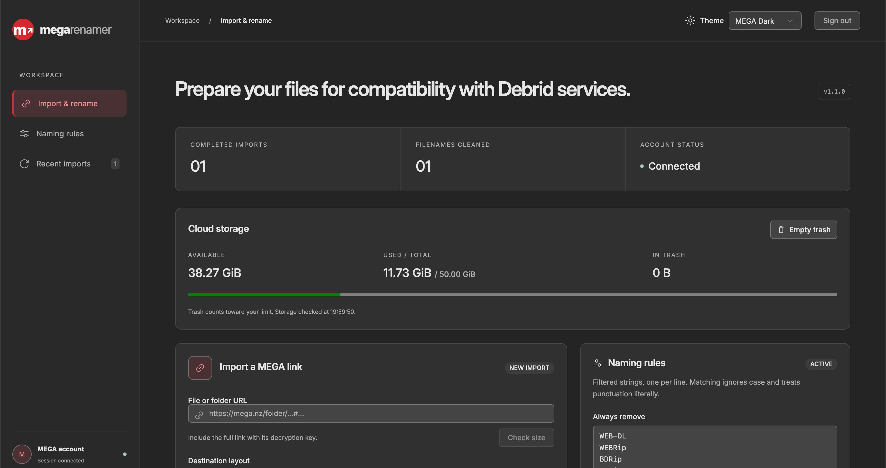

# MEGA Renamer

A self-hosted app that cleans MEGA filenames for debrid services. It removes configured release tags while preserving titles, resolutions, and file extensions. File contents stay in MEGA.



## Setup

Install Docker with Compose, then copy the example configuration:

```sh
git clone https://github.com/tanakrit-d/mega-renamer.git
cd mega-renamer
cp compose.example.yaml compose.yaml
cp .env.example .env
openssl rand -hex 32
```

Set `API_TOKEN` in `.env` to the generated token, then pull and start the published image:

```sh
docker compose pull
docker compose up -d
docker compose exec renamer mega-cmd
```

In the MEGAcmd shell, enter `login your-email@example.com` and follow the password and MFA prompts. Leave the shell with `exit --only-shell` to keep the MEGA session active.

Open [http://localhost:8080](http://localhost:8080) and enter your API token. MEGA credentials are entered inside the container, never through the web interface.

The example uses `ghcr.io/tanakrit-d/mega-renamer:latest` for `linux/amd64`. The MEGA session and app data use separate persistent volumes. Avoid `docker compose down -v` unless you intend to delete them. Your local `compose.yaml` and `.env` are ignored by Git.

The port is bound to localhost. For remote access, use an HTTPS reverse proxy that preserves the request Host header and sets `X-Forwarded-Proto: https`.

## Importing files

Paste a public MEGA file or folder link with its decryption key, then choose a destination layout:

- **Separate folder per import** keeps the source folder structure in `/Imports/<job-id>`.
- **All files in one shared directory** flattens files into `/Imports/Shared`. Name collisions get numbered suffixes, and the layout choice is remembered in your browser.

Each import saves an original-name report before renaming: `original-filenames.txt` for separate imports, or `original-filenames-<job-id>.txt` for shared imports. The report records original names, planned names, and removed tags.

The UI shows progress, activity logs, and public file/report links. Separate imports also get a folder link. Shared imports retain a staging folder for recovery and per-import trash operations.

Imports run one at a time and check available storage before importing. **Check size** lets you check a link beforehand. Failed imports retain files for inspection; retrying creates a new import.

Password-protected links and links to selected subnodes are unsupported. Generated links, including reports, are public.

## Naming rules

Edit **Naming rules** with one literal string per line:

- **Always remove** removes whole tags such as `WEB-DL` and `WEBRip` wherever they occur.
- **Remove only after a resolution** removes tags such as `BluRay.DTS` and `BluRay.DTS-HD` immediately after a dotted resolution.

Matching ignores case, preserves file extensions, and tidies leftover separators. Folder names stay unchanged in separate-folder mode.

| Original | Cleaned name |
| --- | --- |
| `Film.1080p.WEB-DL.mkv` | `Film.1080p.mkv` |
| `Film.2160p.BluRay.DTS-HD.mkv` | `Film.2160p.mkv` |
| `Film.2002.BluRay.DTS-HD.MA.5.1.mkv` | Unchanged: no resolution immediately before the tag |

**Save rules** applies changes to new imports. Queued and existing imports retain their rules. Empty a list to disable that filter. Rules persist across restarts.

## Storage and cleanup

The **Cloud storage** card shows available, used, and rubbish-bin storage.

- **Trash import** moves the import to MEGA's rubbish bin. For shared imports, it collects only that import's recorded files and report.
- **Empty trash** permanently deletes **everything in the account's rubbish bin**, including unrelated files.
- **Trash & empty trash** performs both operations.

Moving files to trash does not free storage; emptying it does. Permanent deletion requires confirmation, and storage totals may take time to update.

**Remove from history** and **Clear history** remove local records only. Cloud files remain in MEGA; use the trash controls first if you also want to remove them.

## Updates and troubleshooting

Pull the latest published image and recreate the container:

```sh
docker compose pull
docker compose up -d
```

Session, rules, and history remain in the persistent volumes. The [publishing workflow](.github/workflows/megacmd-image.yml) checks daily for new MEGAcmd packages. Maintainers can force a rebuild to publish app changes without a new MEGAcmd version.

For failures, check the import's activity log or container logs:

```sh
docker compose logs --tail=200 renamer
```

To build from source instead, replace the `image:` line in your local `compose.yaml` with `build: .`, then run `docker compose up --build -d`.
